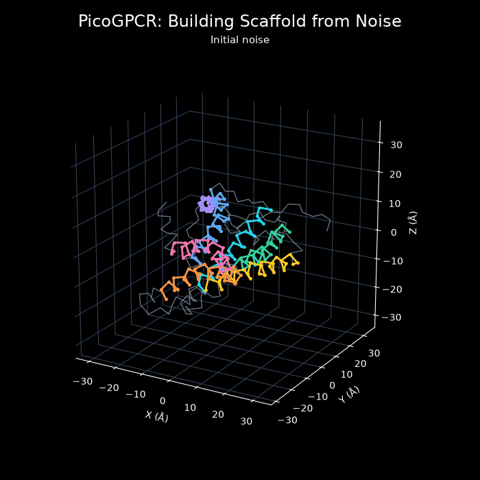

# Picofold-GPCR

A small molecule-conditioned GPCR geometry generator with only 367k parameters. 
~200 lines of code loads data, trains a PyTorch model, and plots the training loss alongside a generated C-alpha backbone.



*200 denoising steps folded on a GPCR scaffold.*

I built PicofoldGPCR after being inspired by [Dave Burke's picofold](https://github.com/daveyburke/picofold). I have been learning protein folding as a means to better understand the workings of GPCR receptors in olfaction, and wanted to follow the same educational approach: keep the learned model small enough to inspect, explain the mathematics alongside the code, and make the result easy to experiment with. This README follows a similar path through the biology, learning method, implementation, and usage, with the focus shifted to olfactory receptor geometry and visualization.
I wanted models that were exportable to the Scentience iOS and Android applications, so this limited the number of ops and layers I could use and drove the requirement for simpler architectures.

The toy task is to take stored molecule features and generate six position and orientation values for each of seven helices in an existing receptor scaffold.
Those 42 pose values deform a fixed C-alpha trace into a new visualization. The core learning methods live in the model classes in [`picogpcr.py`](picogpcr.py).
I wanted to make the sampler, geometry decoder, and viewer small enough to inspect and experiment with for Scentience. 
This minimal version enabled me to get my footing enough to flush out an architecture with a small model that could run on edge hardware.


## Protein and GPCR 101

There are four key points I feel are useful to understand for this tutorial:

1. **A receptor connects chemistry to a cellular response.**
G protein-coupled receptors, or GPCRs, are membrane proteins involved in detecting signals outside a cell. Olfactory receptors belong to this family. A molecule that binds a receptor is called a *ligand*; understanding its interaction with the receptor requires both chemistry and structure. The [OR51E2 study underlying this project's reference](https://doi.org/10.1038/s41586-023-05798-y) provides an experimental example of odorant recognition.

2. **Seven helices give us a manageable shape representation.**
The receptor's seven membrane-spanning helices provide a useful starting point for a constrained model. PicoGPCR keeps each reference helix internally rigid and changes its placement. Connecting loops receive interpolated displacements from that reference geometry. This reduces the number of quantities the network must learn.

3. **A C-alpha trace is a sketch of the backbone.**
The viewer retains one C-alpha, or Cα, coordinate per resolved residue. Its template contains 302 positions from OR51E2, [PDB 8F76, chain A](https://www.rcsb.org/structure/8F76). The source structure was determined with propionate bound. Both run options use this reference trace: option A learns artificial poses, while option B learns poses projected from published molecular-dynamics (MD) frames. The experimental template supplies the displayed scaffold.

4. **For the model, each helix needs six numbers.**
Three numbers are used to translate a helix, and three others describe an axis-angle rotation. Seven helices therefore give a latent vector with $`7 \times (3 + 3) = 42`$ entries. *Latent* here means a compact representation that the decoder converts back into coordinates. The model never generates an amino acid sequence.


## Folding via conditional diffusion

PicoGPCR learns to recover clean helix poses from noisy ones, using molecule features as context. 
Sampling repeatedly applies that denoiser at decreasing noise levels to manifest a fully folded structure.

#### Training

A "clean helix" means the target before diffusion noise is added, such as an artificial helix pose from the given synthetic data, or a pose projected from a frame in the MD dataset (see the "Data & how to run" section).

Let $`z_0 \in \mathbb{R}^{42}`$ be a clean latent vector, $`c \in \mathbb{R}^{265}`$ the molecule features, and $`\epsilon \sim \mathcal{N}(0, I)`$ a noise vector. 
Select a timestep $`t`$ from the 200-level cosine schedule and form:

```math
z_t = \sqrt{\bar{\alpha}_t}\,z_0 + \sqrt{1-\bar{\alpha}_t}\,\epsilon.
```

The schedule value $`\bar{\alpha}_t`$ controls how much clean signal remains. 
Large timesteps contain mostly noise; small timesteps retain more of the original latent. 
The network sees $`z_t`$, the molecule features, and 16 sinusoidal time features $`\phi(t)`$. Its target is the **clean latent**:

```math
\hat{z}_0 = f_\theta(z_t, c, \phi(t)), \qquad \mathcal{L} = \mathbb{E}\left[\frac{1}{42}\left\|\hat{z}_0-z_0\right\|_2^2\right].
```

The central training calculation is:

```python
a = alpha[time, None]                                # (batch, 1)
noisy = a.sqrt() * clean + (1 - a).sqrt() * torch.randn_like(clean)
loss = F.mse_loss(model(noisy, molecule, embedding[time]), clean)
```

Here `alpha` and `embedding` are the precomputed schedule and time-feature tables. 
Training uses batches of 64, AdamW with learning rate `0.001` and weight decay `0.0001`, and gradient clipping at 1. 
Molecule features are set to zero in 20% of training examples so the model also learns without conditioning. 
Generation uses an exponential moving average of the weights, updated with decay `0.99`.

#### Generation

Generation starts from a seeded Gaussian vector and uses 40 [DDIM](https://arxiv.org/abs/2010.02502) steps by default. 
At each step, the clean prediction is clipped to the supported range of the latent vector. 
Hereon, the sampler estimates the noise still present:

```math
\hat{\epsilon}_t = \frac{z_t-\sqrt{\bar{\alpha}_t}\,\hat{z}_0}{\sqrt{1-\bar{\alpha}_t}}.
```

With `--eta 0`, the update for the next, less noisy timestep $`t'`$ is:

```math
z_{t'} = \sqrt{\bar{\alpha}_{t'}}\,\hat{z}_0 + \sqrt{1-\bar{\alpha}_{t'}}\,\hat{\epsilon}_t.
```

At the final update, the next schedule value is 1, leaving the clean estimate. 
Both scripts default to stochastic DDIM (`--eta 0.3`), adding fresh noise that fades to zero at the final update; `--eta 0` restores the deterministic update above.
The seed controls both initial and fresh sampling noise. This changes generated poses, not the training-loss calculation.

This is a crucial adaptation I make to keep the model small and iterative enough for educational purposes: the denoising process operates on seven helix poses, while a fixed geometric decoder supplies detailed reference traces.


## Model code

The default MLP concatenates its three inputs, projects them to a width of 192, passes them through four residual blocks, and produces 42 clean latent values:

```python
x = F.relu(self.input(torch.cat((noisy, condition, time), dim=-1)))
for block in self.blocks:
    x = block(x)
return self.output(x)
```

Each residual block contains two linear layers and a scaled residual branch:

```python
return F.relu(x + 0.5 * self.b(F.relu(self.a(x))))
```

The `Residual` and `PicoGPCR` classes near the top of [`picogpcr.py`](picogpcr.py) contain the default MLP; `HelixAttention` implements the optional attention model.

| Part | Dimensions or contents |
| --- | --- |
| Noisy geometry | 42 values: seven helix poses |
| Molecule condition | 256 fingerprint bits + eight descriptors + one presence flag |
| Time condition | 16 sinusoidal features |
| Input projection | 323 → 192, followed by ReLU |
| Residual stack | Four blocks, each 192 → 192 → 192 |
| Output projection | 192 → 42 |
| Trainable parameters | 366,762 |

The dataset already contains a radius-2, chirality-aware Morgan fingerprint computed by RDKit.
The minimal script loads these features without parsing a new molecule. 
The descriptors summarize molecular weight, logP, polar surface area, hydrogen-bond donors and acceptors, rotatable bonds, heavy-atom count, and formal charge. 
I use a `presence flag` to distinguish a supplied molecule from absent conditioning.

MLP inference is accomplished through: linear layers -> ReLU -> addition -> multiplication -> concatenation. 
The same file also contains the diffusion schedule, training loop, sampler, geometric decoder, and visualization.


#### Optional helix attention model

I baked in an option to add attention to the MLP, for a **568,838-parameter** model: a seven width-128 helix tokens processed by four transformer blocks with four attention heads each. 
Every token is conditioned by molecule and time features. 
The default remains the MLP.
Both models output the same dimensions and pose values and share the sampler, decoder, and plots.

```bash
python picogpcr.py --model attention --data data/md_expanded/dataset.npz --steps 2000 --no-show --out attention.png
python picogpcr_viz.py --model attention --no-show --out attention.gif
```

## Generation code

With `--eta 0` in either script, start from seeded Gaussian noise and apply [DDIM](https://arxiv.org/abs/2010.02502) updates. 
At each step, the model predicts a clean pose, clips it to `[-2, 2]`, and moves to a lower noise level:

```python
clean = model(noisy, condition[None], embedding[time:time + 1]).clamp(-2, 2)
noise = (noisy - alpha[time].sqrt() * clean) / (1 - alpha[time]).sqrt()
noisy = next_alpha.sqrt() * clean + (1 - next_alpha).sqrt() * noise
```

The static plot uses **40 denoising updates**; the GIF defaults to **200**. 
The decoder reshapes the result into seven rows of six values. Each helix is rotated about its reference centroid, then translated. Both options scale translation values by 2 Å. Rotation values use 0.1 radians in option A's v1 schema and 0.5 radians in option B's v2 schema. Interpolation carries the surrounding reference loops along with their endpoints.

The result is a single generated Cα trace, displayed beside the training-loss curve. It is an educational scaffold visualization, not a molecular-dynamics trajectory or an all-atom structure.

## Data & how to run

Use Python 3. From the project folder:

```bash
python -m venv .venv-quickstart
source .venv-quickstart/bin/activate
python -m pip install -r requirements.txt
python picogpcr.py
```

The args all incorporate defaults that can be overridden (see `picogpcr.py`).
The dataset can be run with a strict MLP version or a transformer-based version.

Both prepared datasets and the template are bundled - there are no data downloads are needed.
The `synthetic` option learns a fabricated relationship between the nine demonstration molecules and artificial helix poses.
The `molecular dynamics` option learns simulated conformations projected into the same 42-value representation.

| Dataset | File | Examples |
| --- | --- | ---: |
| Synthetic demo (default) | `data/synthetic/synthetic.npz` | 2,048 artificial poses |
| Molecular dynamics | `data/md_expanded/dataset.npz` | 44,845 simulated frames |

Each run trains from scratch for **2,000 iterations on the CPU**, then saves and displays a black-background figure with the loss curve and generated backbone. The default output is `visuals/picogpcr.png`. Example exports: [synthetic](visuals/picogpcr_synthetic.png) and [MD](visuals/picogpcr_md.png).

To use MD data:

```bash
python picogpcr.py --data data/md_expanded/dataset.npz --out visuals/picogpcr_md.png
```

### GIF animation

[`picogpcr_viz.py`](picogpcr_viz.py) reuses the model and decoder to create an animation of inference.
To regenerate the animation embedded above:

```bash
python picogpcr_viz.py --no-show --out visuals/picogpcr_viz.gif
```

## Limitations

- **Training loss only.** All rows are used for training; there is no held-out validation or test score. Synthetic labels are artificial, and MD frames are correlated simulation observations.
- **Fixed scaffold.** Helices remain rigid and loops are interpolated. The model cannot learn new topology, helix bending, or new loop folds.
- **Educational geometry.** Clipping does not guarantee physically valid packing. Outputs are not binding predictions, docking poses, affinity estimates, or evidence of generalization to unfamiliar molecules.

## Data and credits

- **Inspiration:** [Dave Burke's picofold](https://github.com/daveyburke/picofold), for the small, inspectable learning exercise; [DDIM](https://arxiv.org/abs/2010.02502), for sampling.
- **Template:** Billesbolle et al., *Nature* (2023), [Structural basis of odorant recognition by a human odorant receptor](https://doi.org/10.1038/s41586-023-05798-y). PDB coordinates are [CC0](https://www.rcsb.org/pages/usage-policy).
- **Synthetic data:** artificial feature-to-pose examples generated by PicoGPCR with seed 42.
- **MD data:** Huang, Jianxiang (2026), *CoupledMD: molecular dynamics trajectories of active GPCR–G-protein complexes (replicas 1–3)*, [Zenodo record 23106855](https://doi.org/10.5281/zenodo.23106855), under [CC BY 4.0](https://creativecommons.org/licenses/by/4.0/). PicoGPCR selected compatible trajectories, mapped and aligned residues, filtered equilibration and unsuitable geometry/contacts, projected frames to rigid helix poses, and removed duplicates. The retained frames span 39 trajectories and 14 receptors. Preserve this attribution, license link, and description of changes when sharing the derived data; source identifiers and curation hashes remain in the `.npz` metadata.

## License
[MIT License](LICENSE)
